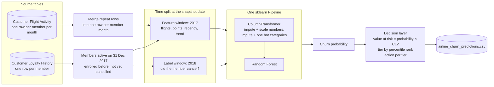

# ✈️ Airline Loyalty Customer Churn


> **Result:** Random Forest ranks members so the top 20% hold about half of all next year churners (2.5× random). Caught and removed a leakage trap that had inflated ROC-AUC from 0.71 to 0.87.

**Business question:** Which airline loyalty members are most likely to cancel in the near future, and which high-value customers should the retention team contact first?

The objective is not only to predict churn, but to help prioritize limited retention offers for members with the highest churn risk and customer value.

This is a retrospective portfolio project using historical cancellation labels. Model metrics and ROI estimates are illustrative, not live airline results.

## System design

### Point in time snapshot: the core of the design



Everything the model sees comes from **before** the snapshot date, and everything it predicts comes from **after** it. This mirrors how the model would be used for real: on 31 December you only know the past, and you want to know who leaves next year. The snapshot keeps the **12,305 members active on that date**, of whom 3.9% cancel during 2018.

**Features from the 2017 window:** flights, distance, points earned and redeemed, months flown, months since the last flight, first half against second half trend, Q4 activity, membership tenure, and profile fields. Identifiers, the single value country column and the cancellation date columns, which define the label, are removed before modelling.

### Why this matters

Cancellations in the data go back to 2013, but flight records only cover 2017 and 2018. A naive approach adds up all activity per member and labels anyone who ever cancelled. Members who left in 2015 then show zero flights, and the model learns "no flights means churned", which is true but useless, because those people are already gone. That shortcut produced a ROC AUC of 0.87. The snapshot design removes it and gives the honest 0.71.

### Design decisions and trade offs

| Decision | Why | Cost |
|---|---|---|
| Single snapshot on 31 Dec 2017 | The only date where a full year of features and a full year of labels both exist | One snapshot means the result cannot be checked across other years |
| Preprocessing inside the Pipeline | Imputation and scaling are fitted again inside every cross validation fold, so no information leaks from the held out folds | Slower cross validation |
| Models compared on PR AUC with 5 fold CV on the training set | With 3.9% churn, accuracy and ROC AUC look good even for weak models; PR AUC does not | PR AUC is less familiar to business readers |
| Threshold chosen from out of fold predictions, maximising F2 | Recall counts double, because missing a churner costs more than one extra offer; the test set stays untouched | 12% precision, so most contacted members were never going to leave |
| Tiers by **percentile rank**, not fixed probability cut offs | The retention team has fixed capacity; "top 10% are high risk" always gives a list of a size they can work through | A member's tier depends on everyone else's score |
| Value at risk = probability × CLV | Ranks a likely churner worth little below a less likely one worth a lot | CLV is taken as given and not checked |

### How it would run in production

A monthly batch job: at each month end, rebuild the 12 month feature window as of that date, score every active member with the saved pipeline, and push the ranked list to the CRM. The model would be retrained when a new year of labels arrives, and checked on a second snapshot before replacing the old one.

### Known gaps

* **Notebook only.** The fitted pipeline is not saved as a file, so scoring new members means running the notebook again.
* **No backtest over time.** With only one usable snapshot, there is no evidence yet that a model trained on 2017 behaviour works on 2019 behaviour.
* **ROI numbers rest on assumptions.** The 10% retained value, 20% save rate and CAD 50 offer cost are illustrative inputs, not measured values.

## Findings

- After removing leakage, **Random Forest** ranks best (hold-out ROC-AUC **0.71**, PR-AUC **0.10** vs 0.04 for random). The earlier ROC-AUC of 0.87 came from members who had already cancelled.
- The **top 20%** of ranked members contain about **half of all 2018 churners** (2.5× random).
- **Tenure** is the strongest signal: first-year members churn at about 10%, against about 3% for longer-tenured members. The lowest quarter of 2017 flyers churn at about 7%, against about 3% for everyone else.
- At the chosen threshold (0.36), the model flags 352 hold-out members and catches **44%** of churners at **12%** precision. Accuracy is not reported as a headline: predicting "nobody churns" scores 96%.

### Model comparison (5-fold CV, training set)

| Model | ROC-AUC | PR-AUC | Recall | Precision |
|:--|:--:|:--:|:--:|:--:|
| **Random Forest** ⭐ | **0.709** | **0.108** | 0.306 | 0.142 |
| Logistic Regression | 0.695 | 0.101 | 0.591 | 0.071 |
| SVM (RBF) | 0.670 | 0.084 | 0.000 | 0.000 |
| KNN | 0.641 | 0.073 | 0.000 | 0.000 |

Random guessing scores a PR-AUC of 0.04 (the churn rate).

### Lift on the hold-out set

| Decile | Churn rate | Lift | Cumulative % of churners |
|:--:|:--:|:--:|:--:|
| 1 | 12% | 3.08× | 31% |
| 2 | 8% | 2.05× | 52% |
| 3 | 4% | 1.13× | 63% |

## Business simulation

The simulation ranks members by **expected value at risk = churn probability × CLV** and compares campaigns against random outreach. The assumptions are illustrative: a CAD 50 offer, 20% success, and 10% of CLV retained. Model-targeted campaigns reach 2–4× more churners (and 3–4× more CLV) than random outreach. However, a CAD 50 offer only breaks even at about a 39% success rate for the top value-at-risk group. That points to a cheaper first touch, or a pilot to measure the real success rate.

## Run the notebook

1. Open [`notebook/Airline_Loyalty_Program.ipynb`](./notebook/Airline_Loyalty_Program.ipynb) in Jupyter or Google Colab.
2. Install the packages: `pip install -r requirements.txt`.
3. Run all notebook cells in order. The source CSV files are in [`DATA/`](./DATA/).
4. The notebook saves hold-out risk scores to [`outputs/airline_churn_predictions.csv`](./outputs/airline_churn_predictions.csv).

The source dataset is from Maven Analytics' Airline Loyalty Program dataset.

## Project structure

```
├── DATA/                      # Maven Analytics source CSVs
├── notebook/
│   └── Airline_Loyalty_Program.ipynb
├── outputs/
│   └── airline_churn_predictions.csv
└── requirements.txt
```

**Stack:** Python · pandas · NumPy · scikit-learn · Matplotlib · Seaborn

Built by [Sidhant Pujara](https://sidhantpujara.vercel.app/)


